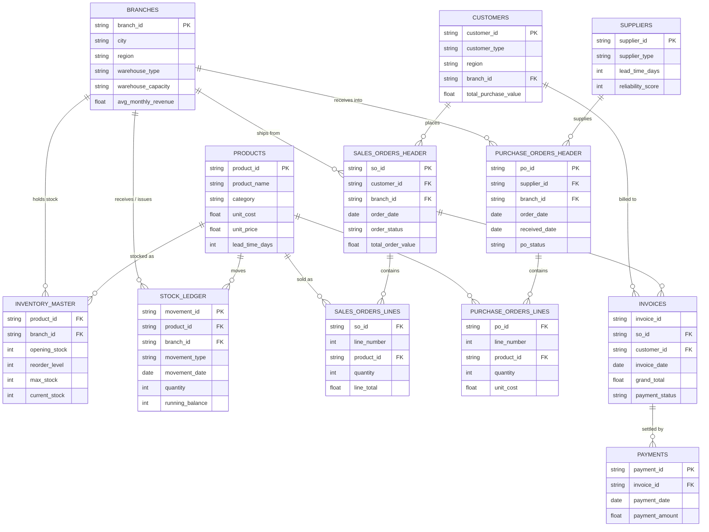

# Entity Relationship Map — Sprint 1

Twelve tables, one star-shaped core: `products`, `branches` and `customers` are dimensions;
`stock_ledger`, order lines and invoices are facts.

## Diagram

## Table grain and keys

| Table | Rows | Grain | Primary key | Foreign keys |
|---|---|---|---|---|
| branches.csv | 6 | one row per warehouse / branch node | branch_id | — |
| customers.csv | 500 | one row per customer | customer_id | b, r, a, n, c, h, _, i, d,  , →,  , b, r, a, n, c, h, e, s |
| inventory_master.csv | 180 | one row per product × branch (snapshot) | product_id + branch_id | p, r, o, d, u, c, t, _, i, d,  , →,  , p, r, o, d, u, c, t, s, ,,  , b, r, a, n, c, h, _, i, d,  , →,  , b, r, a, n, c, h, e, s |
| products.csv | 30 | one row per SKU | product_id | — |
| suppliers.csv | 8 | one row per supplier | supplier_id | — |
| sales_orders_header.csv | 20,000 | one row per sales order | so_id | c, u, s, t, o, m, e, r, _, i, d,  , →,  , c, u, s, t, o, m, e, r, s, ,,  , b, r, a, n, c, h, _, i, d,  , →,  , b, r, a, n, c, h, e, s |
| sales_orders_lines.csv | 130,402 | one row per sales order line | so_id + line_number | s, o, _, i, d,  , →,  , s, a, l, e, s, _, o, r, d, e, r, s, _, h, e, a, d, e, r, ,,  , p, r, o, d, u, c, t, _, i, d,  , →,  , p, r, o, d, u, c, t, s |
| purchase_orders_header.csv | 24,000 | one row per purchase order | po_id | s, u, p, p, l, i, e, r, _, i, d,  , →,  , s, u, p, p, l, i, e, r, s, ,,  , b, r, a, n, c, h, _, i, d,  , →,  , b, r, a, n, c, h, e, s |
| purchase_orders_lines.csv | 155,495 | one row per purchase order line | po_id + line_number | p, o, _, i, d,  , →,  , p, u, r, c, h, a, s, e, _, o, r, d, e, r, s, _, h, e, a, d, e, r, ,,  , p, r, o, d, u, c, t, _, i, d,  , →,  , p, r, o, d, u, c, t, s |
| invoices.csv | 18,033 | one row per invoice (id not unique — see DQ-03) | invoice_id (not unique) / invoice_id + so_id | s, o, _, i, d,  , →,  , s, a, l, e, s, _, o, r, d, e, r, s, _, h, e, a, d, e, r, ,,  , c, u, s, t, o, m, e, r, _, i, d,  , →,  , c, u, s, t, o, m, e, r, s |
| payments.csv | 19,257 | one row per payment | payment_id | i, n, v, o, i, c, e, _, i, d,  , →,  , i, n, v, o, i, c, e, s |
| stock_ledger.csv | 237,230 | one row per stock movement | movement_id | p, r, o, d, u, c, t, _, i, d,  , →,  , p, r, o, d, u, c, t, s, ,,  , b, r, a, n, c, h, _, i, d,  , →,  , b, r, a, n, c, h, e, s, ,,  , r, e, f, e, r, e, n, c, e, _, i, d,  , →,  , S, O, /, P, O |

## Verified join behaviour (Sprint 1 checks)

| Check | Result |
|---|---|
| Sales order header ↔ lines | 0 orders without lines, 0 orphan lines (130,402 lines) |
| Purchase order header ↔ lines | 0 orders without lines, 0 orphan lines (155,495 lines) |
| Invoices ↔ sales orders | every invoice `so_id` resolves, but `so_id` is unique per invoice while `invoice_id` is not |
| Payments ↔ invoices | 0 orphan payments (19,257 rows) |
| Inventory master ↔ stock ledger | same 180 product × branch combinations; closing balance equals `current_stock` for all 180 |
| Products ↔ inventory | all 30 SKUs stocked in all 6 branches (180 = 30 × 6) |

## Three join pitfalls to remember

1. **`invoice_id` is not unique.** 196 IDs appear on two different sales orders, so any
   payment-to-invoice join must key on `invoice_id + so_id`, never `invoice_id` alone.
2. **Two levels of stock thresholds.** `inventory_master` and `products` both carry
   `reorder_level` / `safety_stock` with different values. Declare which one an analysis uses.
3. **Cancelled records stay in the tables.** 1,967 sales orders and 2,370 purchase
   orders are flagged `Cancelled`; revenue and purchase KPIs must filter them explicitly rather than
   assume every row is a completed transaction.
